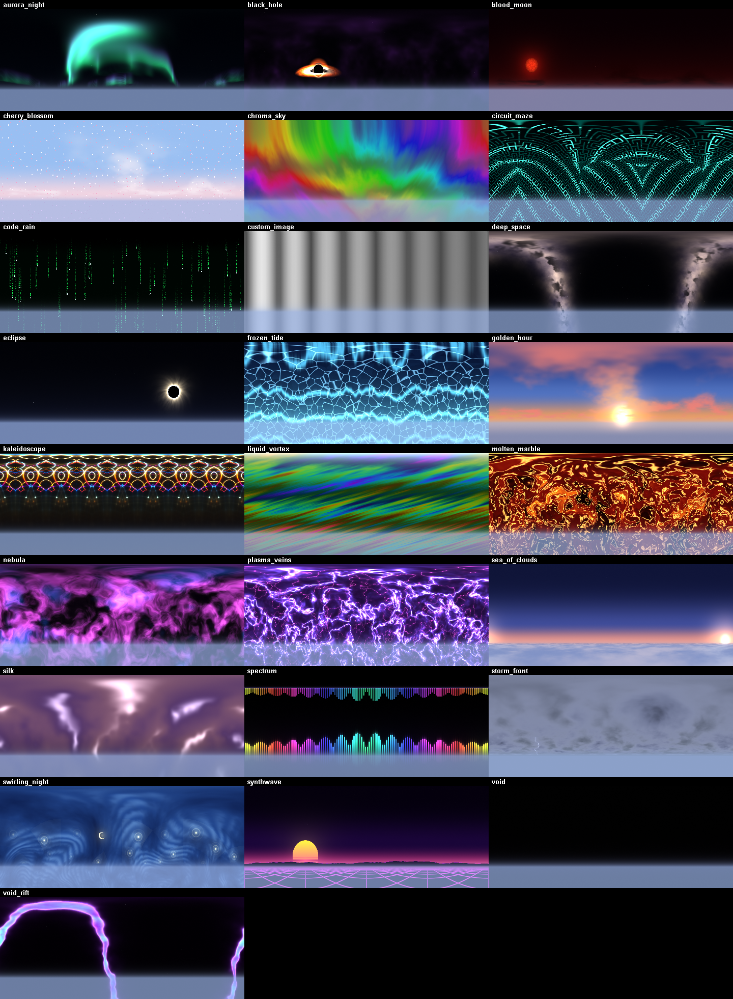

# Dynamic Skies

Animated shader skies for Minecraft 1.8.9 (Ornithe + OneConfig) that can react to music.


# AI Disclosure
This is HEVALY vibecoded mod , feel free to pr to clean up the code^^



## Requirements
- Ornithe loader for 1.8.9 with OSL
- OneConfig (1.8.9-ornithe)

## Usage
Run `/dynamicskies` (or open OneConfig → Visuals → Dynamic Skies).

**Sky:** pick one of 34 animated skies from the Sky dropdown, or run `/dynamicskies browse` for a
browser with live previews of every sky, a big preview of the one you hover, and favorites. Settings include crossfade time, cycling, Night Only,
Match Fog, Opacity, sun and moon, rain fade, and End sky replacement.

**Look:** speed, brightness, saturation, hue shift, tint.

**Audio:**
- *Input Device* listens to a recording device. To react to the music you're playing on your PC,
  use a loopback device: enable **Stereo Mix** (Windows Sound settings → Recording → show disabled
  devices), or install a virtual cable (VB-CABLE, Voicemeeter). With "Audio Device" empty, the mod
  picks a loopback device on its own. Use **List Audio Devices** to see names.
- *Fake Beat* pulses at a BPM you set, with no device needed.
- Reactivity, Sensitivity, Smoothing, Beat Flash, Bass Speeds Up Animation, Audio Hue Shift.

**Layers** (work on top of any sky): Extra Stars, Shooting Stars (random, per-minute rate, and on
strong beats), Aurora, Cloud Wisps.

**Build-Ups & Drops:** with audio on, the mod spots when the bass cuts out for a build-up and slams
back in for the drop. During the build-up the sky speeds up, brightens and glows at the horizon.
On the drop you can have a flash, a shockwave ring, a color shift, a burst of shooting stars and/or
a jump to the next sky. Fake Beat simulates a build-up and drop every 32 beats for testing.

**Custom Shader:** write your own sky in GLSL. Files go in `.minecraft/config/dynamicskies/skies/`;
an `example.fsh` explaining everything you can use is created there the first time you pick
"Custom Shader". With Live Reload on, saving the file updates the sky instantly, and errors show
in chat (a broken edit keeps the last working version).

**Custom Image:** put an equirectangular (2:1) PNG/JPG in `.minecraft/config/dynamicskies/`
and set its file name.

## Adding a sky
1. Add `src/main/resources/assets/dynamicskies/shaders/skies/<id>.fsh` defining `vec3 sky(vec3 d)`.
   Helpers and audio uniforms (`uBass`, `uMid`, `uHigh`, `uLevel`, `uBeat`, `spectrum(x)`) are in
   `common.glsl`.
2. Add it to the end of `SkyType` (the one list of skies; the settings dropdown and the browser
   are filled from it). Never reorder existing entries: the saved setting is the position.

## Build
```
./gradlew build
```
The jar is written to `build/libs/dynamicskies-1.0.0+1.8.9.jar`.
